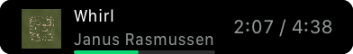

# Spotify Playing

A [Pock](https://pock.app) Touch Bar widget that shows and controls what's playing in **Spotify**.


Since macOS 15.4, Pock's built-in *Now Playing* widget no longer gets track info, because Apple restricted the private MediaRemote framework. **Spotify Playing** talks to Spotify directly, so it works on current macOS versions.

## Download & install

1. Download **`SpotifyPlaying.zip`** from the [latest release](../../releases/latest) and unzip it
2. Double-click **`SpotifyPlaying.pock`** to install it in Pock (or use Pock → *Widgets Manager* → *Install widget…*)
3. Pock → *Customize Touch Bar…* → drag **Spotify Playing** onto the Touch Bar
4. The first time you use it, macOS asks if *Pock* may control *Spotify* → **OK**

> If Pock refuses to load the widget after downloading, run this in Terminal, then restart Pock:
> ```bash
> xattr -dr com.apple.quarantine ~/Library/Application\ Support/Pock/Widgets/SpotifyPlaying.pock
> ```

## Features

| Gesture | Action |
|---|---|
| Tap | Play / pause (starts Spotify if it isn't running) |
| Swipe | Previous / next track |
| Long press | Open Spotify |

- **Three styles**
  
  | Full | Info only | Buttons only |
  |---|---|---|
  |  |  |  |
- Album artwork, and an animated icon while playing
- Progress bar in Spotify green, plus an optional elapsed / total time display
- Instant updates from Spotify's own notification, with no polling
- Option to hide the widget when Spotify has nothing loaded, and to invert the swipe direction

All of these can be changed in Pock → *Widgets Manager* → *Spotify Playing*.

## Requirements

- [Pock](https://pock.app) 0.9.x
- Spotify desktop app
- macOS 10.15 or later (Apple silicon & Intel)

## How it works

| | |
|---|---|
| Track info | `com.spotify.client.PlaybackStateChanged` distributed notification |
| Controls | Spotify's AppleScript interface (via `osascript`) |
| Artwork | Spotify's public oEmbed endpoint |

## Build from source

Requires Xcode and Pock installed in `/Applications`.

```bash
./build.sh            # builds build/SpotifyPlaying.pock and build/SpotifyPlaying.zip
./build.sh --install  # also installs it and restarts Pock
```

The script downloads the PockKit and TinyConstraints sources and compiles only their interfaces. At runtime the widget uses the copies that ship inside Pock.app.

## Credits

Based on [Now Playing](https://github.com/pock/now-playing-widget) by Pierluigi Galdi. MIT License.
